# FreshMart Order-to-Delivery Autopilot

**A team of AI agents that runs the whole purchase-order lifecycle: request, approval, supplier dispatch, chasing, delivery inspection, invoice matching and supplier scoring. Humans only step in for exceptions.**

[](https://logistics-autopilot-supply.ai.studio/)
[](#8-technology-stack)
[](#7-mcp-tool-registry)
[](#8-technology-stack)

**Live app:** https://logistics-autopilot-supply.ai.studio/

---

## Contents

1. [The 30-second version](#1-the-30-second-version)
2. [Problem statement](#2-problem-statement)
3. [How we clarified and solved it](#3-how-we-clarified-and-solved-it)
4. [Architecture](#4-architecture)
5. [Order lifecycle](#5-order-lifecycle)
6. [The agents, one by one](#6-the-agents-one-by-one)
7. [MCP tool registry](#7-mcp-tool-registry)
8. [Technology stack](#8-technology-stack)
9. [Screens and demo walkthrough](#9-screens-and-demo-walkthrough)
10. [API reference](#10-api-reference)
11. [Run locally](#11-run-locally)
12. [Project structure](#12-project-structure)
13. [Known limitations](#13-known-limitations)

---

## 1. The 30-second version

| | |
|---|---|
| **Who** | FreshMart, a supermarket distribution hub. Three roles: **Ravi** (warehouse handler), **Meena** (procurement manager) and the **suppliers**. |
| **Pain** | Orders wait days for approval, suppliers go silent, invoices go missing, and bad deliveries never change which supplier gets the next order. |
| **Idea** | Give each step of the process to a dedicated agent. Rules make the decisions that must be predictable (approval, closing an order, scoring). Gemini handles the messy parts (reading free text, looking at photos, writing summaries). |
| **Result** | Routine orders go from request to supplier purchase order with no human step. Meena sees only exceptions, each with a one-line AI summary. No order can close without proof of delivery and an invoice. Suppliers who deliver damaged goods are scored down and stop receiving new orders. |

---

## 2. Problem statement

Mid-size distribution businesses lose time and money in four places:

| # | Problem | What it looks like today | Cost |
|---|---------|--------------------------|------|
| 1 | **Approval latency** | A simple requisition sits in a manager's inbox for 48 to 72 hours. | Stock-outs, rushed buying |
| 2 | **Silent suppliers** | Nobody confirms or ships. Staff chase by phone and email. | Hours of manual follow-up per order |
| 3 | **Orphan orders** | Goods arrive, the invoice never does, and the order stays open for months. | Reconciliation and audit problems |
| 4 | **No quality feedback** | A supplier ships torn sacks. The incident is handled once and forgotten. The next order goes to the same supplier. | Repeated losses |

### The FreshMart scenario

- **Buyer:** FreshMart Central Distribution Hub
- **Ravi:** logistics handler at the dock, raises requests and receives goods
- **Meena:** procurement manager, sets spend policy and handles exceptions
- **Suppliers (seed data, score out of 10):** Sunrise Rice Co. (8.2), Golden Grain Corp (9.3), Apex Agri Logistics (8.7), Valley Dairy & Provisions (9.1), Metro Pack & Storage (6.8)

---

## 3. How we clarified and solved it

We broke the vague goal "automate procurement" into the four concrete problems above. For each one we asked what actually goes wrong, who should decide, and whether the decision can be a rule or needs AI. That gave us one agent or guard per problem.

| Problem | Clarifying question | Decision | Solved by |
|---------|--------------------|----------|-----------|
| Approval latency | Does every order really need a human? | No. Small orders from good suppliers follow a fixed policy. Only exceptions need a person. | **Approval Agent**: a rule check (value ≤ limit and supplier score ≥ minimum). Exceptions go to Meena with a Gemini-written one-line summary. |
| Typing and form friction | Can staff just say what they need? | Yes. Free text or voice should become a structured order. | **Intake Agent**: Gemini turns "need 500 bags of rice by Friday" into JSON. A regex fallback works without an API key. |
| Silent suppliers | Who follows up, and when do we escalate? | A machine follows up. A human is told only after repeated silence. | **Tracker Agent** (finds stalled orders) and **Chaser Agent** (reminders, escalation after 2). |
| Orphan orders | What must be true before an order can close? | Both a goods receipt and a commercial invoice. | **Complete-Flow Gate** in `POST /api/po/close`: closing is rejected with HTTP 400 unless both exist. |
| No quality feedback | How does a bad delivery change future behaviour? | Update the supplier score, and routing picks the best score. | **Inspection Agent** (Gemini Vision), **Outcome Agent** (score formula), **Self-Healing** (a low score flags the supplier, so new orders pick another one). |
| Manager overload | How does Meena stay informed without reading everything? | A weekly briefing and a chat assistant. | **Insight Agent** and **Logistics Copilot**. |

**Design rule we followed:** rules decide, AI assists. Approval, closing and scoring are deterministic, so they can be audited and tested. AI is used where input is unstructured (text, photos) or where a human reader needs a summary. If Gemini is unavailable, every AI step has a fallback and the demo keeps working.

---

## 4. Architecture

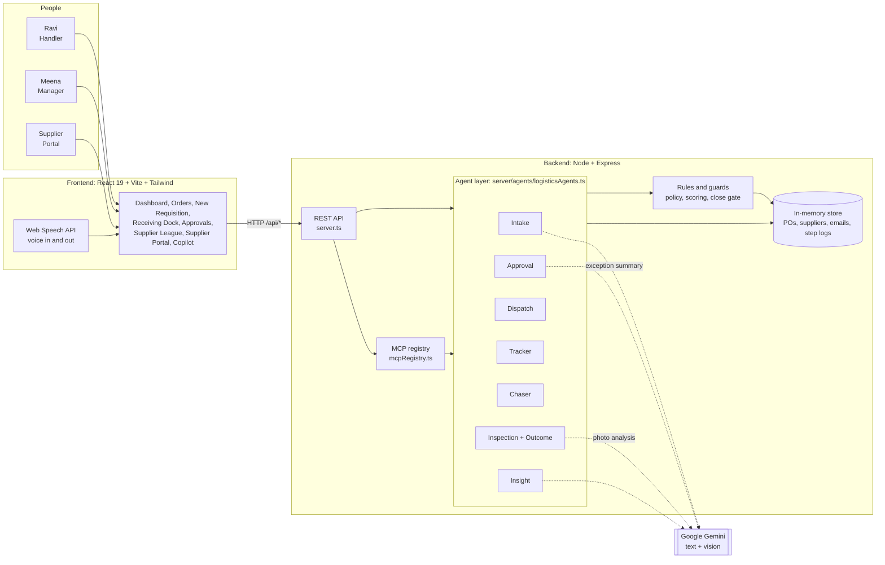

**Reading the diagram**

- **Frontend** has one screen per role task. Voice input uses the browser's Web Speech API.
- **API layer** (`server.ts`) is thin. It validates input, calls an agent, and returns the updated order.
- **Agent layer** holds the business logic. Each agent updates the order and appends a line to the audit trail (`stepLogs`), so you can always see who did what.
- **Rules and guards** are plain code, not AI: policy thresholds, the scoring formula and the close gate.
- **MCP registry** exposes the agent actions as standard tools, so other AI clients can call them.
- **Gemini** is optional. Dotted lines mean "uses AI when a key is configured, otherwise falls back to rules".

### End-to-end flow

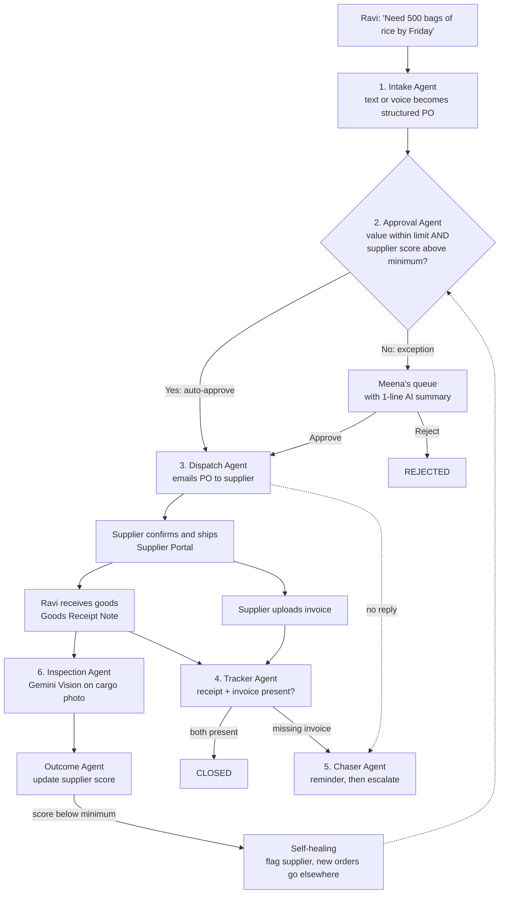

---

## 5. Order lifecycle

Every purchase order follows this state machine. The server enforces the closing rule, so it cannot be bypassed from the UI.

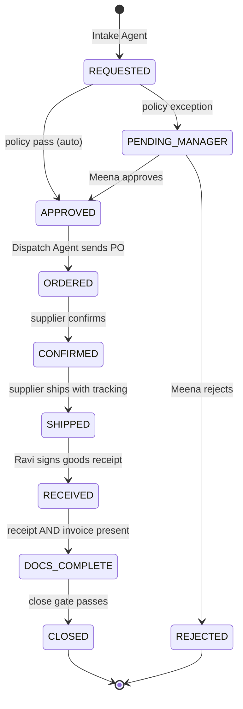

---

## 6. The agents, one by one

The table separates what is **AI** from what is **a rule**.

| # | Agent | Trigger | What it does | AI or rules |
|---|-------|---------|--------------|-------------|
| 1 | **Intake** | `POST /api/intake` | Reads free text or voice and extracts item, quantity, unit, estimated value, needed-by date and category. Creates the PO in `REQUESTED`. | Gemini (JSON output). Regex fallback if there is no key or parsing fails. |
| 2 | **Approval** | Right after intake | Picks the best-scoring supplier for the category, then checks `value <= autoApprovalValueLimit` and `score >= minimumSupplierScore`. Pass: `APPROVED` and auto-dispatch. Fail: `PENDING_MANAGER`. | **Rules** decide. Gemini only writes the one-line summary for Meena (templated text without a key). |
| 3 | **Dispatch** | After approval (auto or manual) | Moves the PO to `ORDERED` and creates the outbound purchase-order email to the supplier. | Rules and templates |
| 4 | **Tracker** | Scheduler tick | Scans received orders. Flags those missing a goods receipt or invoice. Advances complete ones to `DOCS_COMPLETE`. | Rules |
| 5 | **Chaser** | Scheduler tick | Sends reminders for orders stuck in `ORDERED` (no confirmation) or `RECEIVED` (no invoice). After `maxChasesBeforeEscalation` (default 2) it escalates to Meena. | Rules and templates |
| 6 | **Inspection and Outcome** | Receiving Dock | Gemini Vision looks at the cargo photo and returns damage level, damage types, estimated damaged units and confidence. The Outcome step then updates the supplier score. | Gemini Vision. Heuristic fallback from the damaged-unit count you enter. The score update is a **formula**. |
| 7 | **Self-Healing** | After each score update | If the new score is below the policy minimum, the supplier is set to `FLAGGED_REVIEW`. The Approval Agent picks the highest-scoring supplier that is not restricted, so new orders go to a better supplier. | Rules |
| 8 | **Insight** | `GET /api/insights` | Writes a short weekly briefing for Meena from order and supplier metrics. | Gemini. Fixed sample briefing without a key. |
| + | **Logistics Copilot** | Chat or voice | Answers questions such as "why did Sunrise's score drop?" with a short, actionable reply. | Gemini. Canned reply without a key. |

### Supplier scoring formula

```
score = 10 x ( 0.6 x onTimeRate + 0.4 x (1 - damageRate) )      clamped to 1.0 to 10.0
```

`onTimeRate` and `damageRate` are rolling averages over up to the last 20 orders, so one bad delivery lowers a score gradually and repeated problems push it under the 7.0 threshold.

### Default policy (editable by Meena in the UI)

| Setting | Default |
|---------|---------|
| Auto-approval value limit | $2,500 |
| Minimum supplier score | 7.0 / 10 |
| Chase interval | 24 hours |
| Max chases before escalation | 2 |

---

## 7. MCP tool registry

The agent actions are also published as Model Context Protocol tools (protocol `2024-11-05`) so other agents can use them. They are listed at `GET /api/mcp/tools` and run via `POST /api/mcp/execute`. The in-app **MCP Inspector** lets you try them.

| Tool | Purpose |
|------|---------|
| `mcp_intake_order` | Parse a request into a structured PO |
| `mcp_evaluate_approval_policy` | Run the approval policy check |
| `mcp_dispatch_smart_route` | Choose a supplier and dispatch |
| `mcp_tracker_audit_sla` | Audit stalled orders and missing documents |
| `mcp_chaser_escalate` | Send reminders and escalate |
| `mcp_multimodal_cargo_inspect` | Inspect cargo damage |
| `mcp_self_healing_failover` | Recompute supplier score and reroute |
| `mcp_generate_executive_insights` | Produce the weekly briefing |

---

## 8. Technology stack

| Layer | Technology |
|-------|------------|
| Frontend | React 19, TypeScript, Vite, Tailwind CSS v4, Lucide React, Motion |
| Backend | Node.js, Express, `tsx` |
| AI | Google Gemini (`gemini-3.8-flash`) through `@google/genai`: text, JSON output and vision |
| Voice | Browser Web Speech API (dictation and spoken replies) |
| Protocol | Model Context Protocol tool declarations |
| Data | In-memory store with an append-only step log for audit |
| Hosting | Google AI Studio: https://logistics-autopilot-supply.ai.studio/ |

---

## 9. Screens and demo walkthrough

| Screen | Who uses it | Purpose |
|--------|-------------|---------|
| Overview Dashboard | Everyone | KPIs, live order tracker, alerts, agent activity feed |
| Orders & Tracking | Everyone | Search and filter orders, open the order timeline and audit history |
| New Requisition | Ravi | Type or speak a request |
| Receiving Dock | Ravi | Sign goods receipt, upload a cargo photo, run damage inspection |
| Manager Approvals | Meena | Exception queue, policy settings, weekly briefing |
| Supplier League | Meena | Supplier scores, on-time rate, damage rate, status |
| Supplier Portal | Supplier | Confirm PO, add tracking, upload invoice |
| Logistics Copilot | Ravi, Meena | Ask questions in chat or voice |

### Screenshots

Captured from the [live app](https://logistics-autopilot-supply.ai.studio/).

**Overview Dashboard.** KPIs, live status tracker, manager exception queue and missing-document alerts.

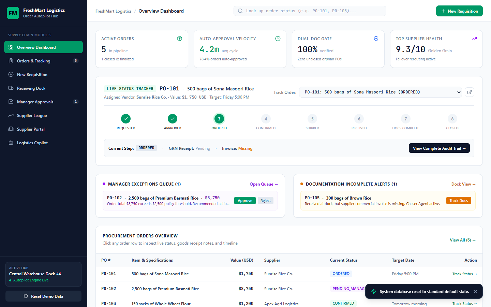

**Orders & Tracking.** Every purchase order with its status and target date.

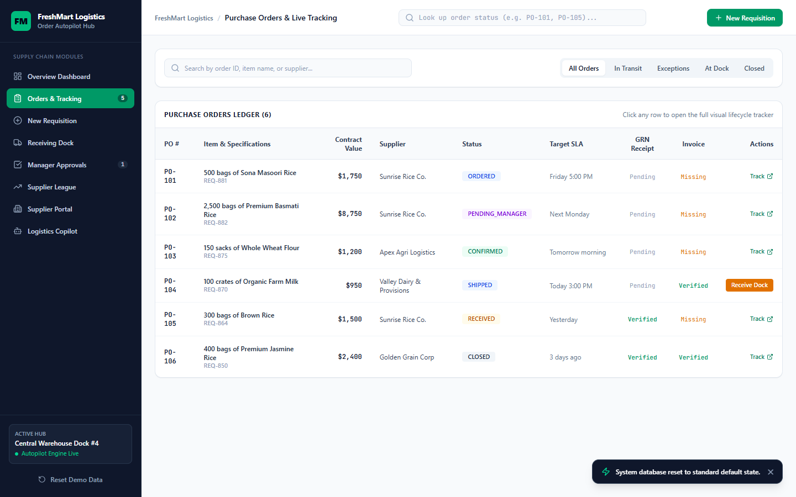

**Order detail.** The eight-step pipeline, approval reason, receipt and invoice state, and the audit log written by each agent.

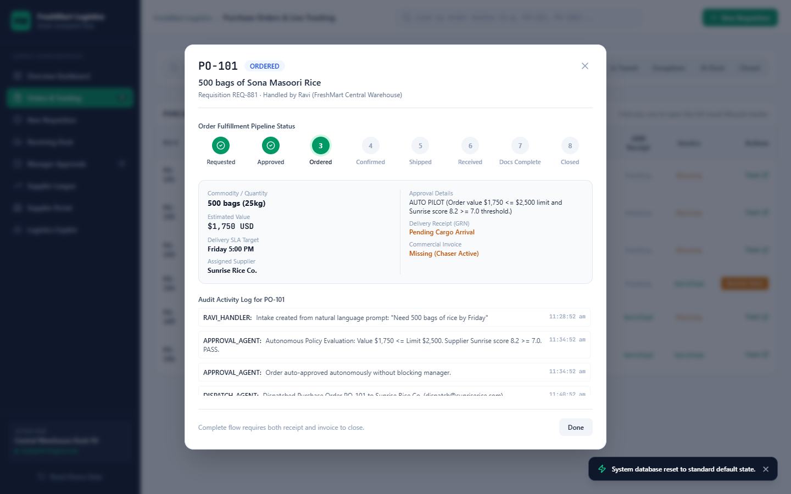

**New Requisition.** Free text in, structured order out.

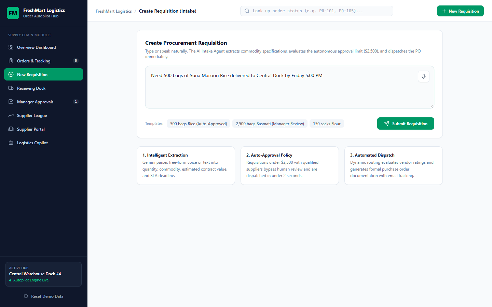

**Requisition result.** The Intake Agent parsed the text. The order is above the $2,500 limit, so the Approval Agent escalated it to Meena with a one-line summary.

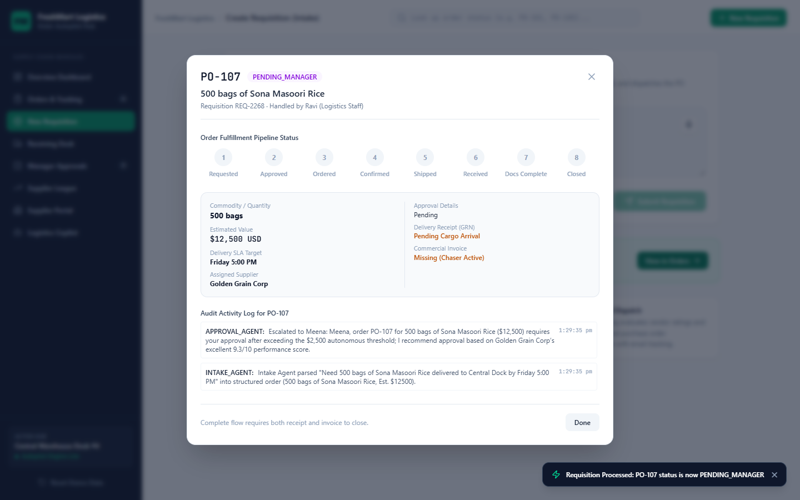

**Receiving Dock.** Multimodal inspection classifies the damage and applies the supplier penalty. The order cannot close until the invoice arrives.

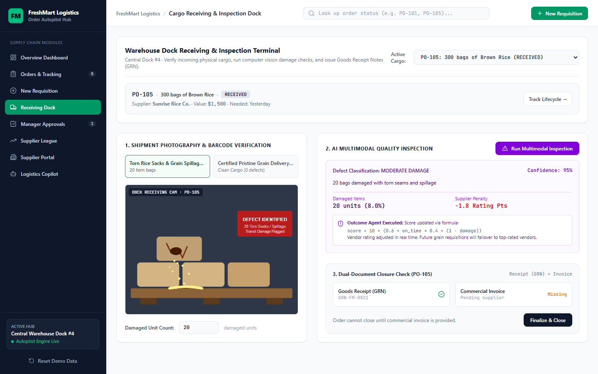

**Receiving Dock with a custom photo.** Choose **Upload Custom Photo** and attach a real delivery photo (JPG, PNG or WebP, up to 10 MB). **Verify Damage with Gemini AI** returns a severity label (here SEVERE DAMAGE, 98% confidence), a written finding, the damaged quantity and the supplier score impact (-3.0 points). Submitting signs the GRN with the damaged units flagged and emails a defect claim to the supplier asking for an amended invoice.

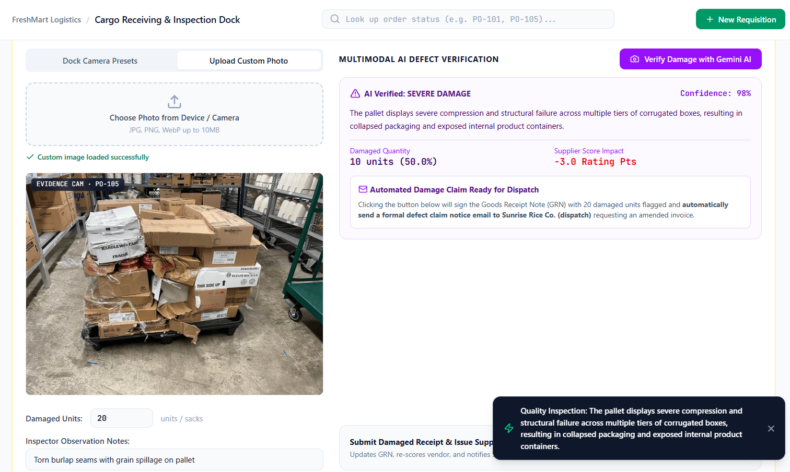

**Manager Approvals and Supplier League.** The exception queue (each item has an AI executive summary), the policy settings (auto-approval limit, minimum supplier rating, chaser interval) and the supplier scorecard with failover ranks. The Supplier League screen shows the same scorecard.

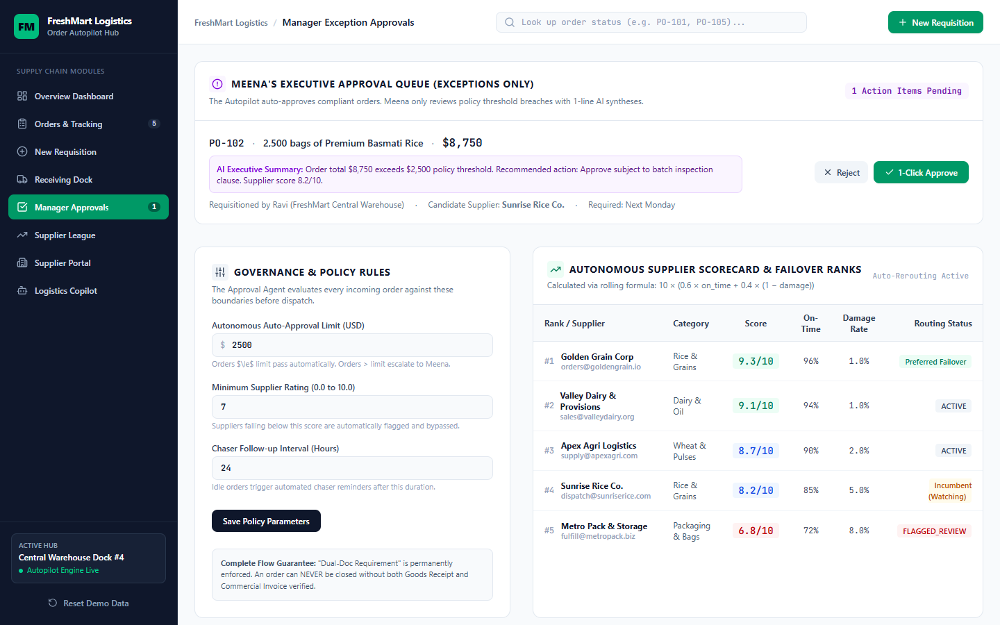

**Supplier Portal.** The supplier's view: confirm orders, upload invoices, and read the dispatch and chaser messages.

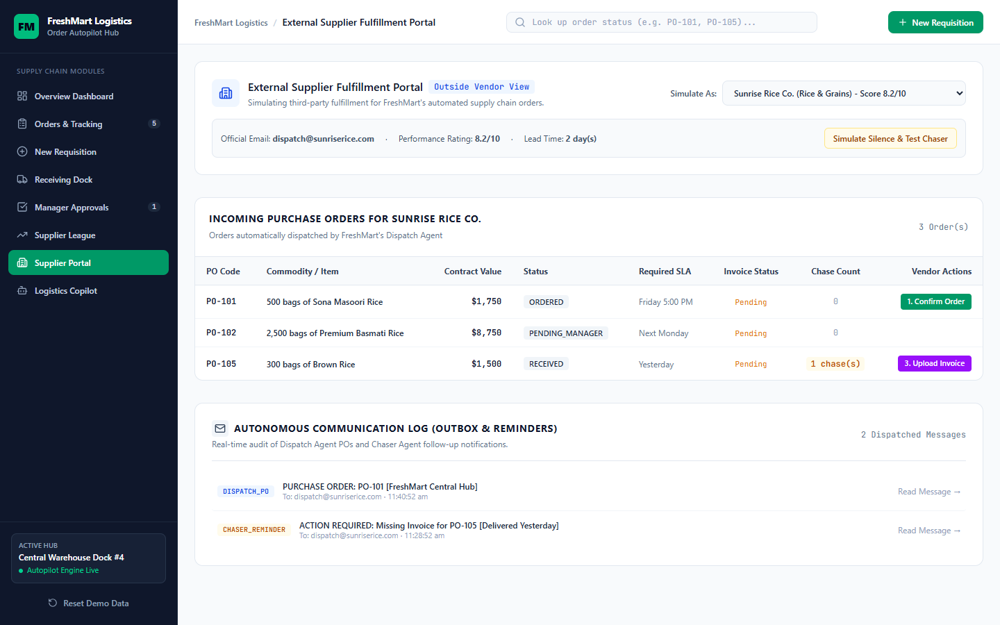

**Logistics Copilot.** Ask why a supplier was downgraded and which one takes precedence.

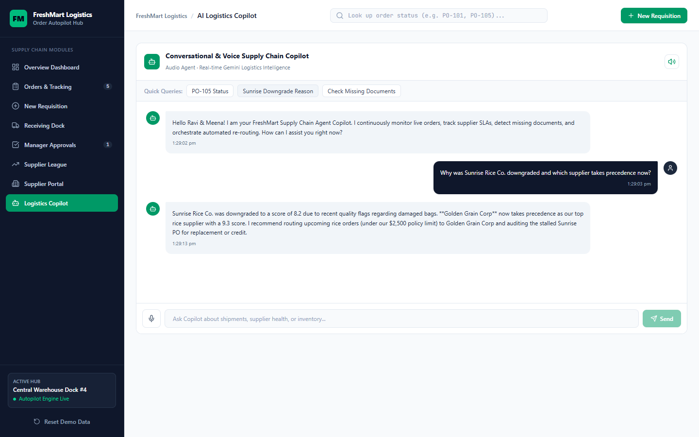

### Try it in about two minutes

1. Open the [live app](https://logistics-autopilot-supply.ai.studio/).
2. **New Requisition:** enter `Need 500 bags of rice by Friday`. If the value is within policy, the order is approved and dispatched with no human step.
3. **New Requisition:** enter a larger order such as `Need 5000 bags of rice`. It lands in **Manager Approvals** with an AI summary. Approve it.
4. **Supplier Portal:** confirm and ship the order, then upload an invoice.
5. **Receiving Dock:** sign the goods receipt, then run inspection with a photo or a damaged-unit count.
6. **Supplier League:** watch the supplier score change. Below 7.0 the supplier is flagged and new orders go elsewhere.
7. **Orders:** try to close an order with only a receipt or only an invoice. It is rejected. With both, it closes.
8. Click **Reset Demo Data** in the sidebar to start again.

---

## 10. API reference

| Method | Endpoint | Purpose |
|--------|----------|---------|
| GET | `/api/state` | Suppliers, orders, latest logs and emails, policy, stats |
| POST | `/api/intake` | Intake then approval for a free-text request |
| POST | `/api/approval/action` | Manager `APPROVE` or `REJECT` |
| POST | `/api/supplier/action` | Supplier `CONFIRM`, `SHIP`, `UPLOAD_INVOICE` |
| POST | `/api/delivery/receive` | Goods receipt at the dock |
| POST | `/api/delivery/inspect` | Damage inspection and score update |
| POST | `/api/po/close` | Close an order (needs receipt and invoice) |
| POST | `/api/scheduler/tick` | Run Tracker and Chaser |
| POST | `/api/policy/update` | Change policy thresholds |
| GET | `/api/insights` | Weekly briefing |
| GET | `/api/mcp/tools` | List MCP tools |
| POST | `/api/mcp/execute` | Run an MCP tool |
| POST | `/api/copilot/chat` | Copilot reply |
| POST | `/api/reset` | Reset demo data |

---

## 11. Run locally

Requirements: Node.js 20 or newer. A Gemini API key is **optional**.

```bash
npm install
cp .env.example .env      # optional: set GEMINI_API_KEY
npm run dev               # http://localhost:3000
```

Without `GEMINI_API_KEY` the app still works end to end. Free-text parsing, summaries, photo inspection and chat use the built-in fallbacks described above.

---

## 12. Project structure

```
server.ts                      Express app and all /api routes
server/
  agents/logisticsAgents.ts    Intake, Approval, Dispatch, Tracker, Chaser, Inspection/Outcome, Insight
  mcpRegistry.ts               MCP tool declarations and executor
  gemini.ts                    Gemini client with graceful fallback
  db.ts                        In-memory store, seed data, supplier scoring
src/
  App.tsx                      Screen routing
  components/                  Dashboard, Orders, Intake, Receiving Dock, Approvals, Suppliers, Copilot, MCP Inspector
  types/logistics.ts           Shared types (order statuses, suppliers, emails)
PRESENTATION.md                Presentation notes
```

---

## 13. Known limitations

- **Data is in memory.** It resets when the server restarts. A real deployment would use a database.
- **Emails are simulated.** Purchase orders and reminders are written to the in-app mailbox, not sent through an email service.
- **The scheduler runs on demand.** Tracker and Chaser run when `/api/scheduler/tick` is called, not on a background timer.
- **No authentication.** Roles are screens, not logins.
- **Demo numbers are illustrative.** Dashboard stats, the fallback weekly briefing and the figures in `PRESENTATION.md` (for example "48 hours to a few minutes" and "78.4% auto-approved") are seeded demo values, not measured results.
